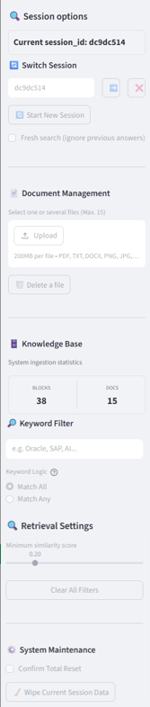
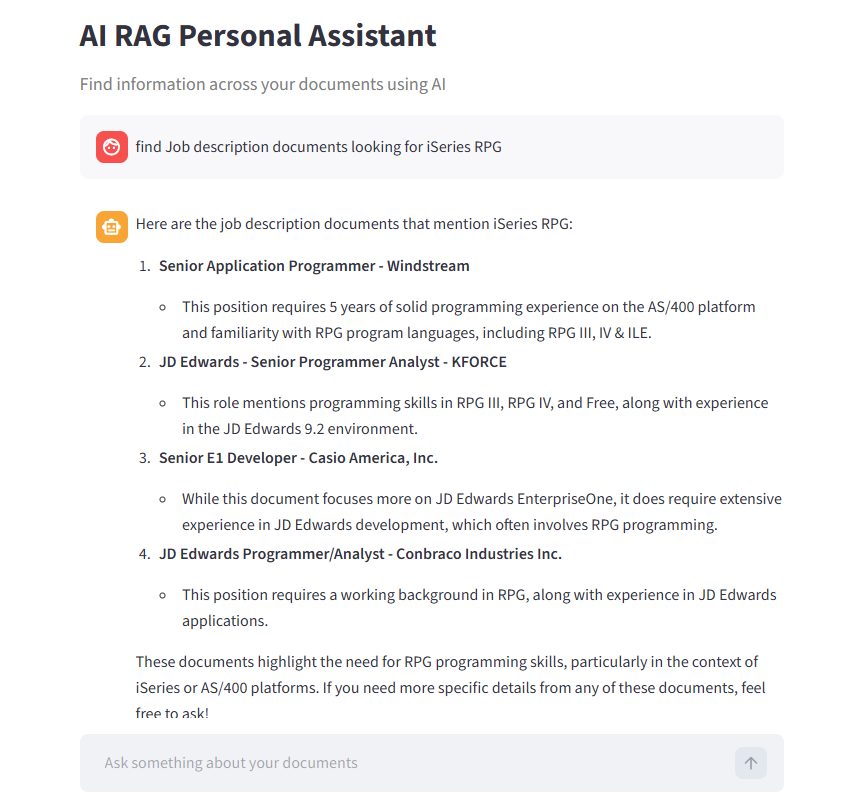

# 🧠 AI Personal Assistant (Multimodal)

An enterprise-grade **Retrieval-Augmented Generation (RAG)** application. 
Unlike basic RAG setups, this assistant uses a multi-stage pipeline including 
**RankGPT reranking** and **contextual query condensation** to ensure highly accurate, conversational answers.
[](https://maingpy-6tg79pvqkn8plxpn7lsxsc.streamlit.app)

---

## 🌟 Key Technical Features

*   **Multimodal Ingestion**: Seamlessly indexes PDFs, DOCX, TXT, and **Images** (via OpenAI Vision OCR).
*   **Advanced Retrieval Pipeline**:
    *   **Stage 1**: Semantic Vector Search.
    *   **Stage 2**: Metadata & Keyword Filtering (Hard-match constraints).
    *   **Stage 3**: **RankGPT Reranking** (Uses LLMs to re-order the top results for maximum relevance).
*   **Stateful Conversational Memory**: Uses `CondensePlusContext` logic to handle complex follow-up questions (e.g., "Summarize *that* document").
*   **Explainable AI (XAI)**: Provides a "Sources & Evidence" panel with similarity scores and snippet previews for every claim made.
*   **FAQ Integration**: Supports a vetted `faqs.json` for instant, authoritative answers to common queries.

---

## 🏗️ The Pipeline Architecture

```text
User Input → Query Condenser (History Aware) → Vector Search (Top 10) 
     ↓
Similarity Filter (min_score) → Keyword Hard-Filter 
     ↓
RankGPT Reranker (Top 3) → LLM Synthesis → Final Answer + Citations
```

---

## 🛠️ Tech Stack

*   **Framework**: [LlamaIndex](https://llamaindex.ai) (Data Orchestration)
*   **Frontend**: [Streamlit](https://streamlit.io/)
*   **Models**: OpenAI GPT-4o (Reasoning), GPT-4o-mini (Reranking/Vision), Text-Embedding-3-Small
*   **Vector Store**: ChromaDB / SimpleVectorStore
*   **Language**: Python

---

## 🚀 Quick Start

### 1. Clone & Setup

```bash
git clone https://github.com/luisrvq/docs_fexplo.git
cd docs_fexplo
python -m venv venv
source venv/bin/activate  # venv\Scripts\activate on Windows
pip install -r requirements.txt
```
```bash
python -m venv venv
venv\Scripts\activate   # Windows
# source venv/bin/activate  # Mac/Linux
```

### 2. Configuration
Create a `.env` file in the root directory:
```env
OPENAI_API_KEY=your_api_key_here
```
### 3. Install dependencies

```bash
pip install -r requirements.txt
```

---

## ▶️ Run the app

```bash
streamlit run maing.py
```

---

## ☁️ Deploy on Streamlit Community Cloud

1. Push your code to GitHub
2. Go to: https://streamlit.io/cloud
3. Click **"New app"**
4. Select your repo and branch
5. Set the main file:

   ```
   mainf.py
   ```
6. Add secrets:

```toml
OPENAI_API_KEY = "your_api_key_here"
```

7. Deploy 🚀

---

## 📁 Project Structure

```
.
├── app/
├── data/                # Uploaded documents
├── maing.py             # Streamlit UI, session state management, and file handling
├── rag_pipelineg.py     # The core RAG logic, custom retrievers, and reranking post-processors
├── requirements.txt
├── .gitignore
├── {} faqs_maing.json   # Pre-vetted Q&A pairs for high-precision retrieval
└── README.md
```

---

## ⚠️ Notes

* “Open Folder” works only locally (desktop environment)
* In cloud, files are available via **Download button**
* Large files may impact performance

---

## 🔮 Future Improvements

- [ ] **Hybrid Search**: Combining BM25 (keyword) with Vector search.
- [ ] **Local LLM Support**: Integration with Ollama for privacy-focused queries.
- [ ] **Streaming Responses**: For a more "ChatGPT-like" typing experience.

---
## 📸 Screenshots

### Sidebar & Controls


### Chat & Sources


---

## 👤 Author
Luis Solis Vasquez

---

## ⭐ If you like this project or find it helpful, please give it a star! **

